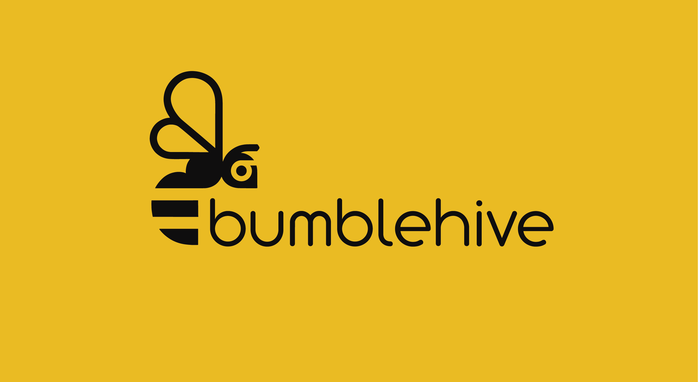
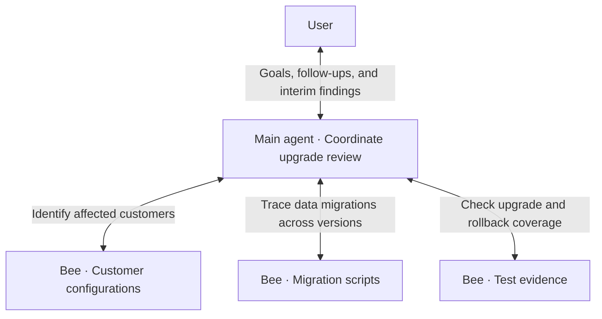

<div align="center">



**小核心，大轰鸣 | Small Core, Big Buzz**

A lightweight Python SDK for building a complete Agent Loop in just a few lines of code.

[](https://pypi.org/project/bumblehive/)
[](https://www.python.org/)
[](https://github.com/wxhcore/bumblehive/actions/workflows/sdk-ci.yml)
[](https://modelcontextprotocol.io/)
[](https://opensource.org/licenses/Apache-2.0)
[](https://linux.do)

English | [简体中文](./README_zh.md)

</div>

---

## Try It in 30 Seconds

Install the Python SDK:

```bash
python -m pip install bumblehive
```

Set `BUMBLEHIVE_MODEL`, `BUMBLEHIVE_API_KEY`, and `BUMBLEHIVE_BASE_URL`, then run:

```python
import asyncio
import os

import bumblehive


async def main():
    config = bumblehive.RuntimeArguments(
        model=os.environ["BUMBLEHIVE_MODEL"],
        api_key=os.environ["BUMBLEHIVE_API_KEY"],
        base_url=os.environ["BUMBLEHIVE_BASE_URL"],
    )
    async with bumblehive.from_config(config) as runtime:
        await runtime.run_console("Explain Agent Runtime in one sentence.")


asyncio.run(main())
```

`run_console()` displays the answer directly in your terminal. See the [quickstart](https://wxhcore.github.io/bumblehive/getting-started/installation/) for installation and environment setup.

## Choose a Run Method

| API | Best for |
| --- | --- |
| `run_console()` | Trying or debugging an Agent in the terminal |
| `run()` | Getting a structured result for a Python application |
| `stream()` | Consuming runtime events in a custom interface |

## Core Capabilities

- Manage model calls, the Agent Loop, and resource lifecycles through Runtime.
- Give an Agent Python functions, built-in tools, or MCP servers.
- Add streaming events, conversation history, persisted sessions, Skills, and observability hooks when needed.

## Hive Collaboration

BumbleHive Desktop uses the BumbleHive Python SDK to implement Hive, a multi-agent architecture for coordinating long-running tasks that can be split into parallel work.

- **Two-level agent architecture.** The main agent acts as the Router. It delegates tasks, coordinates work, and brings the results together. Bees act as Workers, handling their assigned tasks in parallel in the shared workspace, each in its own conversation.
- **Asynchronous two-way messaging.** After delegating, the main agent can keep talking with you or send follow-up instructions to a specific Bee. The Bee sends its results back to the main conversation.
- **Event-driven coordination.** Each Bee triggers a notification when it finishes or fails, so the main agent can act on an early finding while other investigations are still running.

> “We’re moving existing customers from v1 to v3. Use the customer configurations, migration scripts, and test records in this repository to propose a phased rollout. Which customers need more verification first?”



**Keep working while a slower investigation runs.** While the configuration Bee is still tracing customer settings, you can ask “What risks have we found so far?” or add “The first group must be able to roll back to v1.” The main agent can share confirmed findings and pass the new constraint to the migration and test Bees while the configuration review continues.

Suppose the migration Bee finds that v3 drops a legacy field. As soon as that Bee finishes, its report reaches the main conversation. The main agent can ask the configuration Bee which customers still use that field and the test Bee whether rollback restores its value. The final plan can then identify who can upgrade first, who should wait, and what still needs verification.

## Next Steps

The English documentation is in progress. See the [English overview](https://wxhcore.github.io/bumblehive/en/), the [complete Chinese documentation](https://wxhcore.github.io/bumblehive/), or the runnable [examples](examples/README.md).

| Goal | Start here |
| --- | --- |
| Make the first Agent call | [Quickstart (Chinese)](https://wxhcore.github.io/bumblehive/getting-started/installation/) |
| Add a Python tool | [Register a tool (Chinese)](https://wxhcore.github.io/bumblehive/getting-started/first-tool/) |
| Save a conversation | [History and sessions (Chinese)](https://wxhcore.github.io/bumblehive/how-to/memory-and-sessions/) |
| Load task instructions | [Skills (Chinese)](https://wxhcore.github.io/bumblehive/how-to/skills/) |
| Connect external tools | [MCP (Chinese)](https://wxhcore.github.io/bumblehive/how-to/mcp/) |
| Look up a public API | [API Reference (Chinese)](https://wxhcore.github.io/bumblehive/reference/runtime/) |
| Browse runnable code | [Examples](examples/README.md) |

## Local Development

The Python SDK, Server, and WebUI development workflow supports macOS, Windows, and Ubuntu Linux. It requires Python 3.11+, Node.js 22.12+, and pnpm 10.33.0. A dedicated Conda environment is recommended:

```bash
pnpm run setup
```

`pnpm run setup` is the only project setup entry point. It installs every Node workspace dependency from the root lockfile, then uses the active Python interpreter to install the SDK, Server, test, and desktop packaging dependencies before running the core environment check. `pnpm run dev` repeats that lightweight preflight before starting either process. If a requirement is missing, the command stops with a targeted error. The same command works on Ubuntu Linux and does not require the desktop system toolchain. Set `BUMBLEHIVE_PYTHON` to an interpreter path to override the active interpreter.

For daily development:

```bash
pnpm run dev
```

This starts the Server on `127.0.0.1:18421` and the WebUI on `127.0.0.1:1420`. Use `pnpm run dev:server` or `pnpm run dev:web` to run one component, and `pnpm test` for the Python test suite.

### Desktop

The optional desktop workflow currently targets macOS and Windows. macOS additionally requires Rust and Xcode Command Line Tools. Windows additionally requires the Rust MSVC toolchain, WebView2, and Microsoft C++ Build Tools with the Desktop development with C++ workload.

After the shared `pnpm run setup`, start development or create the installer for the current platform:

```bash
pnpm run dev:desktop
pnpm run build:desktop
```

Both commands verify Rust, Tauri, and the platform toolchain, then automatically package the Python Server as a sidecar before starting Tauri. `build:desktop` creates an app and DMG on macOS or an NSIS installer on Windows.
